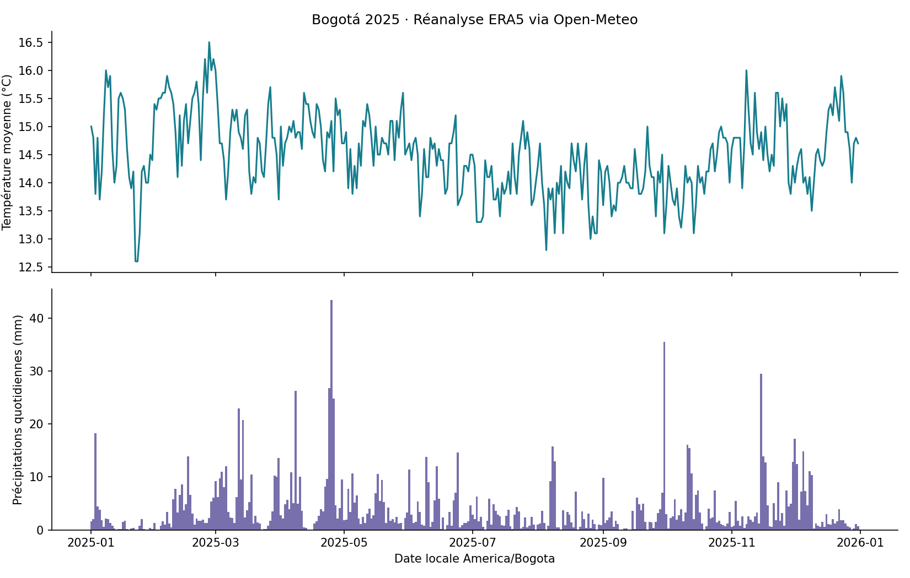
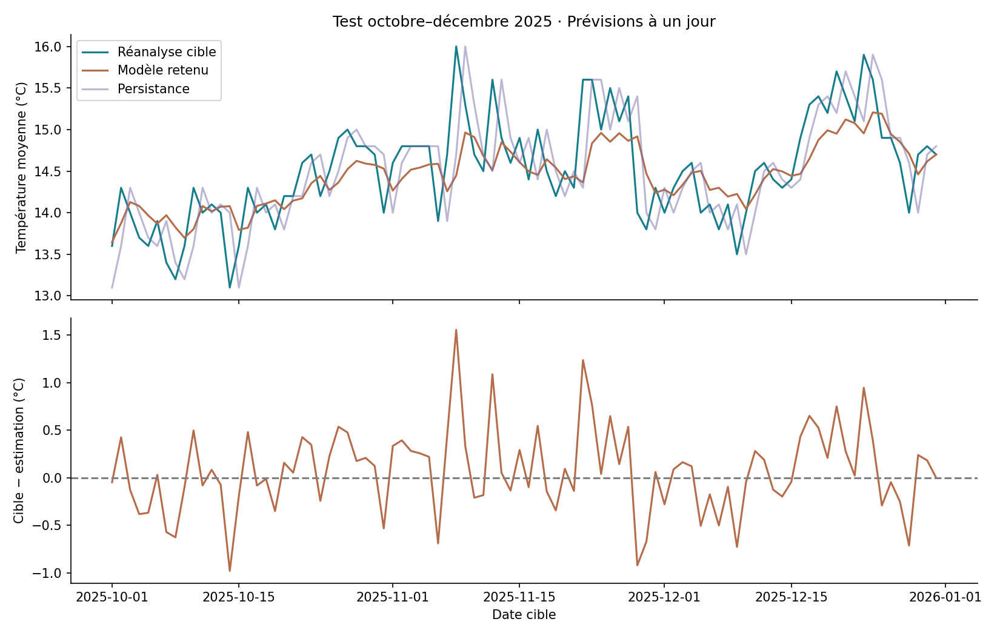

# Premier test réel de collecte API — Bogotá 2025

Une requête HTTP à l’API historique Open-Meteo a été exécutée pour latitude 4,7110, longitude −74,0721, année 2025, modèle ERA5, fuseau America/Bogota. Résultat : 365 dates quotidiennes, température moyenne (°C) et précipitations (mm), contrôlées et exportées en CSV.

Ce sont des données de **réanalyse**, issues d’un modèle combinant différentes sources, et non des mesures directes d’une station locale. Les coordonnées de grille réellement renvoyées sont consignées dans les résultats.

## Réutiliser le dossier
```sh
python collecter.py             # réutilise la réponse préservée et vérifie les sorties
python collecter.py --refresh   # refait la requête, archive l'ancienne réponse
```
Python standard uniquement. Pas de clé API pour cette démonstration non commerciale. Données sous CC BY 4.0 ; attribution à Open-Meteo et Copernicus ERA5. Une utilisation commerciale du service, notamment dans une offre payante, doit suivre les conditions commerciales du fournisseur.

La collecte enregistre la réponse brute, vérifie les dates et unités, crée `collected/bogota_2025.csv`, puis enchaîne directement l’analyse mensuelle dans `analysis/mensuel.csv`. Aucune manipulation de fichiers intermédiaires n’est nécessaire.

## Connecter DataCollect
`action-openapi.json` est un schéma d’action préparé pour l’API de lecture. Dans l’éditeur du GPT, il peut servir à créer une action avec authentification « aucune ». Tester d’abord une petite période, puis vérifier les dates, unités, valeurs absentes, fuseau et coordonnées renvoyées. La compatibilité de ce schéma avec l’éditeur n’a pas encore été testée.

Exemple de demande : « Collecte les températures moyennes et précipitations ERA5 de Bogotá du 1 au 31 janvier 2025, fuseau America/Bogota, puis contrôle les dates et unités. »

**État exact : l’API a été appelée depuis le script ; aucune connexion n’a été installée dans les trois GPT.** Ajouter cette action à DataCollect ne suffit pas à transmettre les fichiers entre GPT indépendants. Pour cela, il faut un stockage partagé et un coordinateur ou service commun réellement accessible à chacun.

Un modèle de température moyenne à J+1 a maintenant été exécuté. Lire `reports/rapport_analyse_modele.md` et `models/fiche_modele.md` pour son protocole et ses limites. Une réanalyse n’est pas une prévision qui aurait été disponible au moment d’une décision passée ; ne pas l’utiliser comme telle pour un backtest.

Documentation : https://open-meteo.com/en/docs/historical-weather-api. Conditions : https://open-meteo.com/en/terms. Il n’y a ni collecte planifiée ni surveillance permanente configurée.


## Analyse et modèle : une seule commande
```sh
python -m pip install -r requirements.txt
python executer_pipeline.py              # collecte en cache, analyse, entraînement et export
python executer_pipeline.py --refresh    # nouvel appel API, puis même parcours
python predire.py                        # illustration historique du lendemain de la série
```

Le modèle Ridge choisi obtient une MAE de 0,340 °C sur le test, contre 0,391 °C pour la persistance. Ces résultats correspondent à la réponse brute conservée dans ce dossier. Les valeurs de 2025 servent à une démonstration rétrospective, pas une prévision actuelle.


## Résultats illustrés



Modèle entraîné sur 205 jours, choisi sur 61 jours de validation puis évalué sur 92 jours de test. MAE test 0,340 °C, contre 0,391 °C pour la persistance, soit 13,0 % de réduction. Le modèle ne garantit pas une prévision opérationnelle : la réanalyse est rétrospective et une seule année est disponible.
