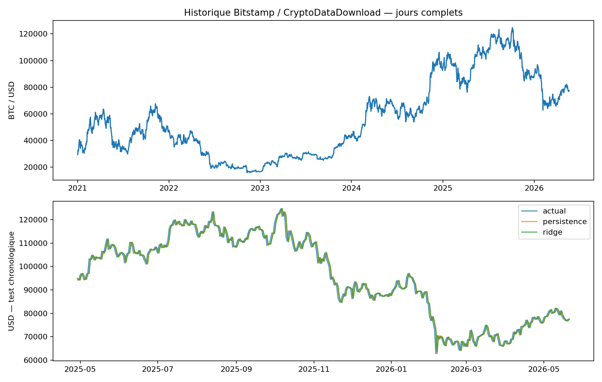

# Bitcoin DataLab : du téléchargement au test d’un modèle
**Junior BOOTO Waba · Python & analyse de données · Étude historique expérimentale**

[Présentation sur mon site](https://junior-booto-fle.juniorbooto.chatgpt.site/bitcoin-datalab.html) · [Rapport détaillé](docs/rapport.md) · [Résultats vérifiés](reports/results.json)

## Problème et résultat
Prévoir la clôture BTC/USD du lendemain à partir des données disponibles après la clôture du jour. La collecte, l’analyse et l’entraînement ont été exécutés. Le modèle Ridge retenu en validation **ne surpasse pas la référence sur le test final**.

| Méthode | MAE sur test (USD) | RMSE sur test (USD) |
|---|---:|---:|
| Persistance : cours inchangé | 1 425,70 | 1 961,90 |
| Ridge | 1 445,10 | 1 975,12 |



## 1. Collecter et contrôler
Source : [CryptoDataDownload / Bitstamp](https://www.cryptodatadownload.com/data/bitstamp/), paire BTC/USD. Téléchargement CSV structuré exécuté, plutôt que scraping HTML. Yahoo a renvoyé HTTP 429 ; la provenance n’a pas été confondue avec Yahoo.

Le fichier brut contient 4 336 lignes. Pour l’étude : **1 967 journées consécutives, du 1er janvier 2021 au 21 mai 2026**. Le 22 mai est absent : période ultérieure exclue, aucune interpolation. Les dates proviennent des timestamps Unix convertis en UTC. Vérifications : dates uniques, continuité, valeurs manquantes, cours positifs, cohérence OHLC et volumes non négatifs.

## 2. Analyser
Rendements quotidiens, volatilité, amplitude et volume. Sur la période retenue : écart-type quotidien 3,05 % ; baisse maximale des clôtures −76,66 %. Ces mesures décrivent cet historique et ne prédisent pas les risques futurs.

## 3. Modéliser sans utiliser le futur
Sept variables connues à la clôture : rendements 1/3/7 jours, volatilité 7/30 jours, amplitude et variation du volume. Cible : rendement à J+1, reconstruit en cours USD. Découpage chronologique 60/20/20 avec une observation de séparation. Standardisation apprise dans le pipeline uniquement sur entraînement.

Ridge et forêt limitée comparés sur validation ; Ridge choisi avant lecture du test. Évaluation finale de Ridge et de la persistance sur les mêmes jours. Export et rechargement des deux modèles vérifiés ; la forêt reste un candidat, pas le modèle retenu.

## 4. Reproduire
```bash
python -m pip install -r requirements.txt
python src/pipeline.py data/processed/btc_usd_daily.csv --out reproduced
```
`environment.json` enregistre les versions effectivement utilisées. Les données sélectionnées sont figées pour reproduire l’étude ; aucune actualisation ou collecte permanente n’est installée.

## Organisation
| Dossier | Rôle |
|---|---|
| src/ | Pipeline de contrôles, analyse, entraînement et export |
| data/raw/ | CSV original préservé |
| data/processed/ | Sélection quotidienne normalisée |
| reports/ | Graphique, métriques, prédictions et résultats |
| models/ | Ridge et forêt expérimentaux |
| docs/ | Rapport, dictionnaire et droits de réutilisation |
| manifest.json | Provenance et état du parcours |

## Limites
Données d’un seul échange ; historique arrêté en mai 2026. Pas de prévision actuelle, stratégie de trading, performance de portefeuille ou service déployé. Aucun avantage prédictif démontré. Le test consulté ne peut pas être réutilisé comme test indépendant pour sélectionner de nouveaux modèles. Les fichiers joblib ne doivent être chargés que depuis une source fiable.

## Attribution et droits
Données : Bitstamp via CryptoDataDownload, [CC BY-NC-SA 4.0](https://creativecommons.org/licenses/by-nc-sa/4.0/), selon la déclaration du fournisseur. Usage non commercial, attribution et partage à l’identique. Voir [droits](docs/droits.md). Les livres de référence ne sont pas redistribués.

## Compétences illustrées
Collecte HTTP, contrôle de qualité, traitement de dates UTC, séries temporelles, pipelines scikit-learn, validation chronologique, comparaison à une référence et documentation de résultats négatifs. Projet d’apprentissage documenté, sans expérience professionnelle en finance revendiquée.
