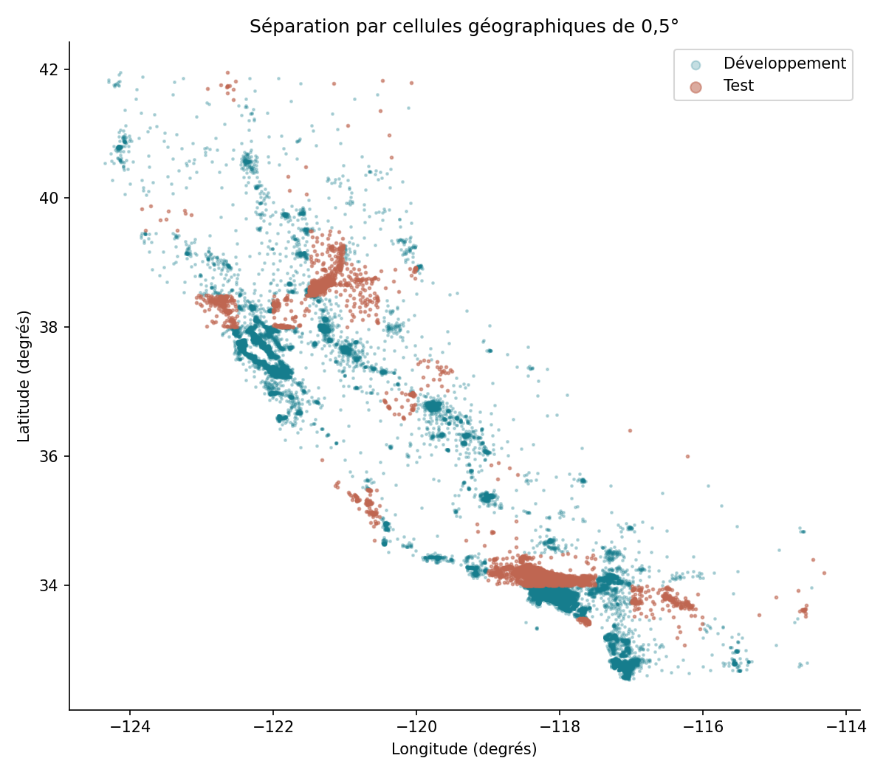
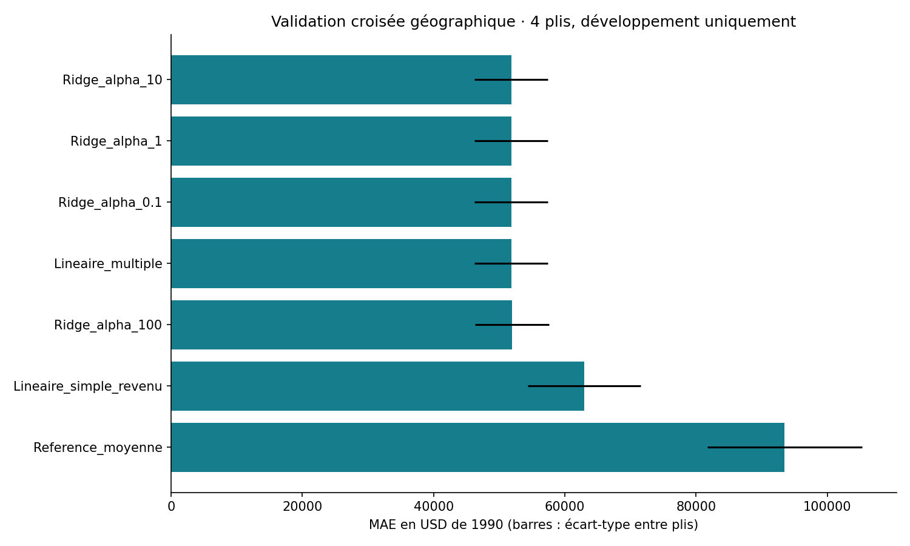
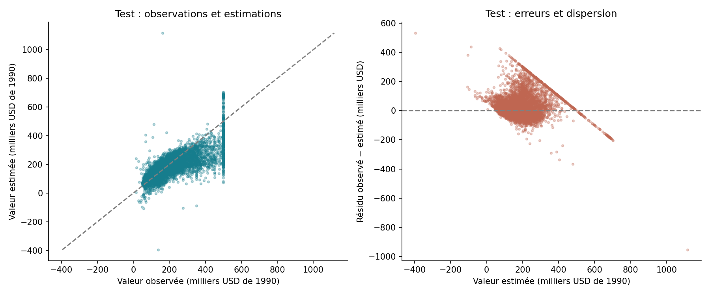

# California Housing — Régressions linéaires et validation géographique
**Junior BOOTO Waba · Projet 10 · Python et modélisation prédictive**

Comparer une référence moyenne, une régression simple, une régression multiple et Ridge pour estimer la **valeur médiane des logements par zone de recensement**. Chaque ligne est une zone, pas une maison individuelle.

Le projet adapte l’exercice Boston Housing de *Data Analysis Projects* vers California Housing. Boston est déconseillé pour cet usage par les mainteneurs scikit-learn ; l’objectif d’apprentissage de la régression est conservé avec une alternative documentée.

## Résultat exécuté
**Ridge α=10**, choisi sur quatre plis géographiques de développement, est évalué sur **5 744 observations de test** mises à part :

| Indicateur | Modèle retenu | Référence moyenne |
|---|---:|---:|
| MAE (USD de 1990) | 56 753 | 87 191 |
| RMSE (USD de 1990) | 83 356 | 116 571 |
| R² | 0,475 | −0,027 |

La MAE baisse de **34,9 %** par rapport à la référence. Le modèle ne prédit pas des prix actuels. R² n’est pas un pourcentage de précision.

## Protocole
- 20 640 zones, huit variables numériques, aucune valeur manquante.
- Cellules géographiques de 0,5° ; 20 % des **cellules**, pas des lignes, sont mises en test avec `GroupShuffleSplit`.
- 14 896 lignes / 140 cellules en développement ; 5 744 lignes / 36 cellules en test.
- `GroupKFold` à quatre plis sur développement uniquement. Standardisation réapprise dans chaque pli.
- Choix par MAE moyenne en validation ; test final du modèle retenu et de la référence uniquement.
- Export JSON des coefficients et de la standardisation ; rechargement vérifié sur toutes les estimations test.

## Reproduire
Python 3.11 ou plus :
```sh
python -m pip install -r requirements.txt
python entrainer.py
```
Le script télécharge l’archive utilisée par scikit-learn si elle est absente, vérifie le SHA-256 connu, préserve les données brutes, prépare les statistiques de développement, ajuste les modèles et écrit les rapports. Internet est nécessaire au premier lancement.

## Consulter
- [Rapport](reports/rapport.md), [sources](reports/sources.md) et [fiche modèle](models/fiche_modele.md)
- [Validation croisée](analysis/validation_croisee.csv), [test et entraînement](analysis/scores_finaux.csv)
- [Erreurs sur les valeurs plafonnées](analysis/erreurs_par_plafond.csv)
- [Coefficients](analysis/coefficients.csv), [modèle JSON](models/regression.json) et [manifeste](manifest.json)





## Limites à connaître
Données du recensement 1990. La cible présente un plafond à 500 001 USD pour 992 observations. Les cellules de test sont distinctes, mais peuvent être voisines des cellules de développement : aucun tampon spatial n’est imposé et il ne s’agit pas d’une validation temporelle.

28 estimations de test sont négatives et restent signalées sans correction postérieure au test. Les erreurs importantes et les valeurs plafonnées limitent l’usage opérationnel. Les coefficients décrivent des associations conditionnelles, pas des effets causaux. La sélection Ridge et la régression multiple non régularisée sont presque à égalité en MAE de validation ; cet écart ne prouve pas un avantage significatif de Ridge.

Source : California Housing, Pace & Barry (1997), données du recensement américain 1990, distribuées via StatLib/scikit-learn. Le dépôt et l’archive du projet fournissent le code et les résultats ; l’archive source est récupérée par le script plutôt que redistribuée.
