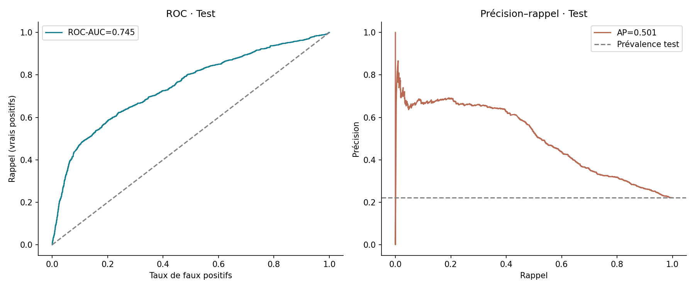
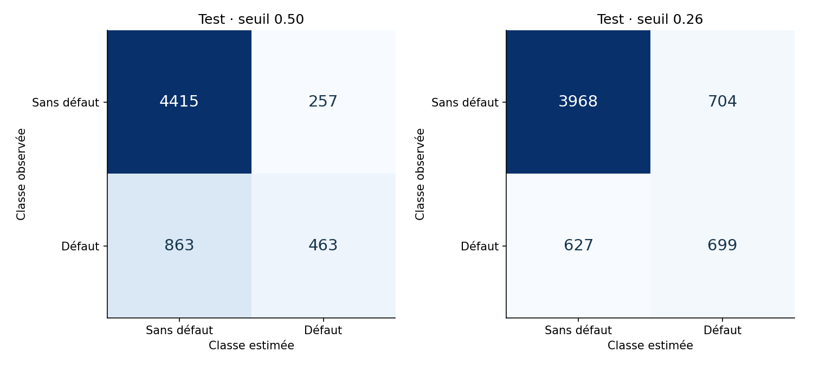
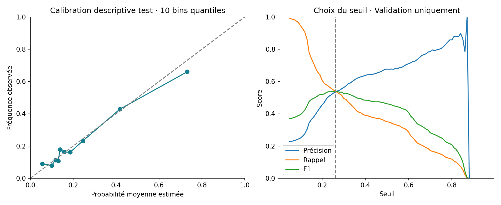

# Défaut de paiement — Régression logistique et évaluation
**Junior BOOTO Waba · Projet 11 · Python et classification binaire**

Étudier un jeu public historique de Taïwan, comparer une référence majoritaire et une régression logistique, puis expliquer seuils, probabilités et erreurs. Ce projet ne décide pas de l’accès d’une personne au crédit.

## Résultat exécuté
30 000 observations ; 22,12 % de défauts. Modèle sur **19 variables financières**, sans ID, sexe, âge, éducation ou situation matrimoniale.

Sur 5 998 observations de test :
- ROC-AUC **0,745** ; Average Precision (AP) **0,501**, contre **0,221** pour une référence constante.
- Au seuil **0,26**, choisi par F1 sur validation : précision **49,8 %**, rappel **52,7 %**, F1 **0,512**.
- 699 défauts détectés, 627 manqués, 704 faux positifs, 3 968 vrais négatifs.

Un seuil plus faible détecte davantage de défauts que 0,5, au prix de plus de faux positifs. La classe majoritaire obtient déjà 77,9 % d’accuracy en ne détectant aucun défaut : l’accuracy seule ne suffit pas.

## Protocole
1. Source UCI et checksum vérifiés ; fichiers bruts préservés.
2. Profils identiques sur les variables financières gardés dans le même ensemble.
3. 17 996 lignes d’apprentissage, 6 006 de validation, 5 998 de test, avec séparation stratifiée par profils.
4. Standardisation des 13 montants et encodage des six statuts ajustés seulement sur apprentissage.
5. C=0,1 / 1 / 10 comparés sur validation par AP ; C=0,1 retenu. Seuil choisi sur validation par F1.
6. Test après les choix ; aucune recalibration ou retouche fondée sur le test.

## Reproduire
Python 3.11 ou plus :
```sh
python -m pip install -r requirements.txt
python entrainer.py
python exemple_local.py
```
Le premier lancement récupère l’archive UCI si elle manque. Le script vérifie son empreinte, puis produit les calculs et graphiques. Le fichier brut et les dossiers individuels ne sont pas redistribués dans ce portfolio ; le code permet une reproduction locale à partir de la source publique.

## Fichiers
- [Rapport](reports/rapport.md), [sources](reports/sources.md) et [fiche modèle](models/fiche_modele.md)
- [Comparaison en validation](analysis/comparaison_validation.csv), [choix de seuil](analysis/seuils_validation.csv)
- [Scores de test](analysis/scores_test.csv), [calibration](analysis/calibration_test.csv)
- [Audit agrégé](analysis/audit_groupes_agrege.csv), [export JSON](models/logistique.json), [manifeste](manifest.json)





## Limites
Taïwan, historiques avril–septembre 2005, horizon du mois suivant. Aucun test temporel ou externe. Les probabilités ne sont pas recalibrées ; la courbe et le Brier mesurent leur fiabilité descriptive, sans garantie individuelle. Le seuil F1 n’est pas un seuil économique validé.

Les codes de statut −2 et 0 présents dans le fichier ne sont pas explicités dans la description UCI : ils restent des catégories distinctes. Les 817 profils financiers répétés sont conservés, sans supposer qu’il s’agit de dossiers techniques dupliqués ; leur séparation entre ensembles est interdite.

L’exclusion de variables démographiques ne prouve pas l’absence de biais. Un audit agrégé par sexe documente quelques écarts, sans certifier l’équité. Aucune campagne, décision de crédit ou notation individuelle en ligne n’est lancée.

Source : Yeh, I. (2009), *Default of Credit Card Clients*, UCI, DOI **10.24432/C55S3H**, licence **CC BY 4.0**. Inspiration : *Data Analysis Projects*, Natacha Njongwa Yepnga / LeCoinStat, projet 11.
