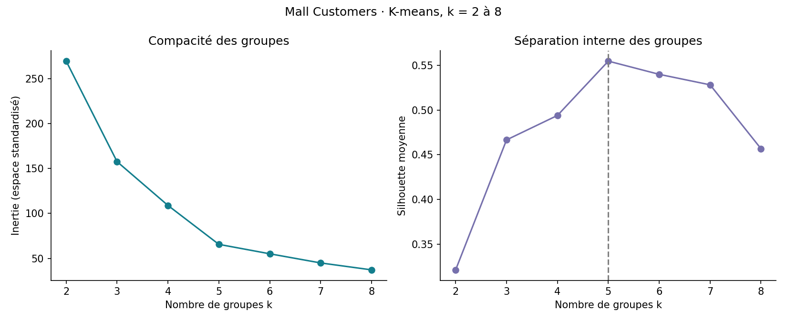
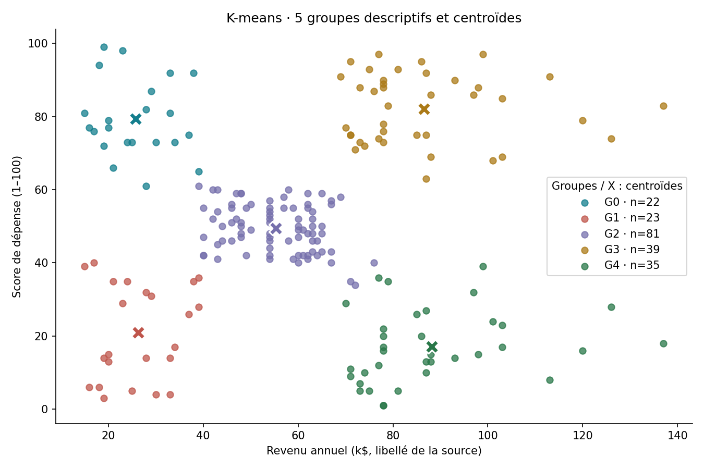
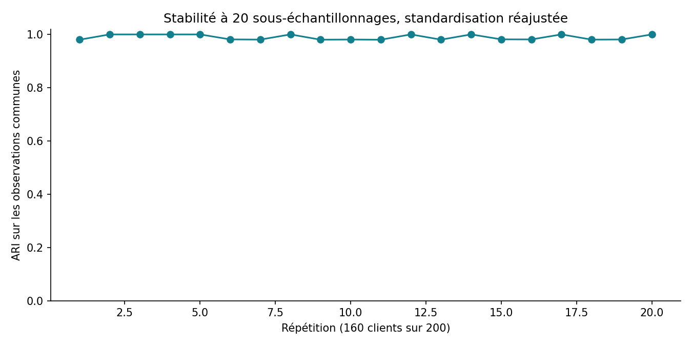

# Mall Customers — Segmentation exploratoire par clustering
**Junior BOOTO Waba · Projet 9 · Python et machine learning non supervisé**

Comparer K-means, Ward et DBSCAN sur 200 profils pédagogiques, expliquer les groupes et vérifier leur sensibilité aux choix de données.

## Résultats exécutés
- 200 identifiants uniques ; aucune valeur manquante ni profil entièrement répété.
- Deux variables primaires : revenu annuel et score de dépense, standardisés.
- **5 groupes** retenus parmi K-means k=2 à 8, silhouette **0,555**.
- ARI moyen **0,989** sur les observations communes de 20 sous-échantillons de 80 %.
- Ajout de l’âge à k fixé : ARI **0,584** par rapport aux groupes initiaux. Le choix des variables change donc nettement les regroupements.

L’ARI mesure l’accord entre partitions, pas une précision de prédiction de 98,9 %. Ces groupes ne prouvent pas des catégories naturelles de clients ni l’efficacité d’une stratégie commerciale.

## Reproduire
Python 3.11 ou plus :
```sh
python -m pip install -r requirements.txt
python analyser.py
python predire_groupe.py
```
Le premier script récupère le CSV auprès du dépôt cité par la fiche Kaggle, à un commit fixé, puis vérifie l’empreinte Git. Internet est nécessaire au premier lancement. Les données brutes sont préservées. Le CSV source n’est pas redistribué : ses conditions de redistribution ne sont pas clairement identifiées.

## Parcours coordonné
DataCollect contrôle source, identifiants, types et plages. DataAnalyse produit les statistiques et documente les exclusions. DataML compare les méthodes, examine la stabilité, exporte le modèle numérique et vérifie son rechargement. Un seul script réutilise les fichiers partagés ; il ne contacte pas automatiquement les trois GPT indépendants.

## Fichiers
- [Rapport](reports/rapport.md) et [sources](reports/sources.md)
- [Comparaison des méthodes](analysis/comparaison_methodes.csv)
- [Choix de k](analysis/choix_k.csv), [profils agrégés](analysis/profils_groupes.csv) et [stabilité](analysis/stabilite_sous_echantillons.csv)
- [Fiche modèle](models/fiche_modele.md) et export `models/kmeans.npz`
- [Manifeste](manifest.json) et code reproductible





## Limites
Aucune validation commerciale indépendante. K et les métriques sont explorés sur les mêmes 200 observations. La formule du score de dépense, la période, le pays et la représentativité ne sont pas documentés. Le genre et l’identifiant sont exclus ; l’âge est réservé à une analyse de sensibilité. Cela ne garantit pas l’absence de biais.

DBSCAN exclut 11,5 % des observations comme bruit : sa silhouette sur les observations regroupées ne se compare pas directement à celle des méthodes couvrant 100 % du jeu. Ward est comparé au même k que K-means ; son nombre de groupes n’est pas optimisé séparément.

Inspiration : *Data Analysis Projects*, Natacha Njongwa Yepnga / LeCoinStat, projet 9. Dataset pédagogique Mall Customer Segmentation Data, fiche de Vijay Choudhary, issue du cours Machine Learning A-Z selon sa description. Code d’analyse rédigé pour ce projet ; données et auteurs de la source restent attribués.
