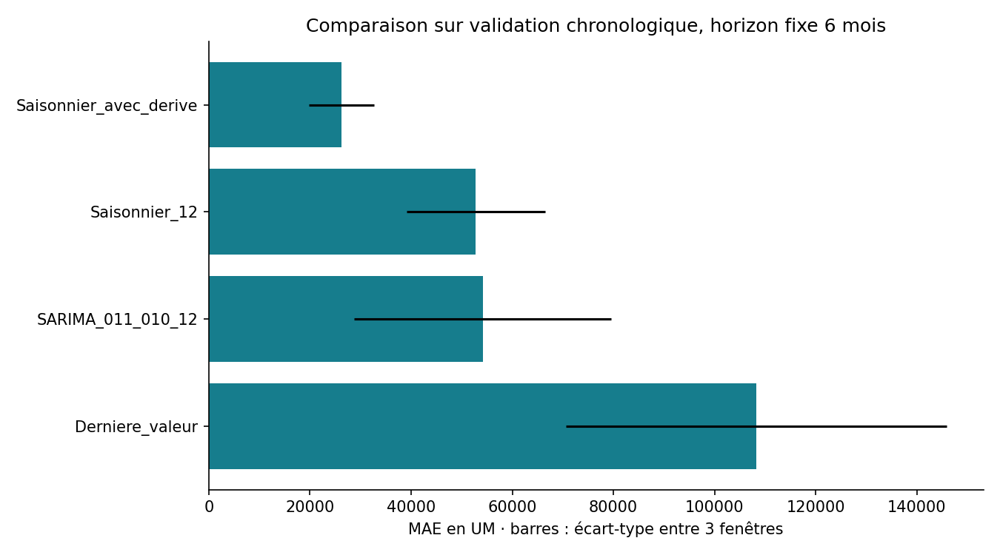
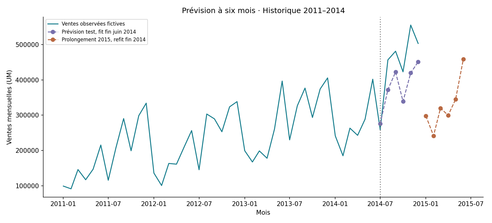

# Prévision des ventes — Validation chronologique à six mois
**Junior BOOTO Waba · Projet 12 · Séries temporelles en Python**

Prolongement du tableau de bord Global Superstore : comparer dernière valeur, référence saisonnière, saisonnalité avec dérive et SARIMA sur 48 mois fictifs, de janvier 2011 à décembre 2014.

## Résultat exécuté
La méthode **saisonnière avec dérive** est retenue en validation. Sur juillet–décembre 2014 :

| Indicateur | Méthode retenue | Référence saisonnière |
|---|---:|---:|
| MAE (UM) | 71 958 | 111 964 |
| RMSE (UM) | 80 650 | 120 991 |
| WAPE | 16,1 % | 25,1 % |

Réduction de MAE : **35,7 %**. Le SARIMA testé n’apporte pas d’amélioration en validation ; il n’est pas retenu par principe.

## Méthode
Horizon fixe de six mois. Trois validations à origine glissante : prévisions faites fin décembre 2012, fin juin 2013 et fin décembre 2013. Chaque fit ne voit que les mois précédents. Le choix est la MAE moyenne minimale sur ces fenêtres.

Le test final utilise les six derniers mois de 2014, avec fit jusqu’à juin 2014. Seuls la méthode retenue et le témoin saisonnier sont évalués ; aucun réglage après consultation du test.

La méthode choisie prévoit chaque mois comme le même mois un an plus tôt, plus la moyenne des différences annuelles observées dans son historique d’apprentissage. SARIMA testé : (0,1,1)×(0,1,0,12), sans exogènes, spécification fixée avant le test.

## Reproduire
Python 3.11 ou plus :
```sh
python -m pip install -r requirements.txt
python prevoir.py
```
Le petit CSV source contient des **agrégats mensuels** déjà vérifiés dans le projet 7. Il est inclus pour la reproduction hors réseau. L’historique et les paramètres de la méthode retenue sont exportés en JSON, sans pickle.

## Livrables
- [Comparaison en validation](analysis/comparaison.csv) et [scores par fenêtre](analysis/validation_fenetres.csv)
- [Test final](analysis/test_final.csv) et [prévisions détaillées du test](analysis/predictions_test.csv)
- [Prolongement hypothétique 2015](analysis/prolongement_2015.csv)
- [Modèle numérique](models/prevision.json), [rapport](reports/rapport.md), [sources](source.json) et [manifeste](manifest.json)




## Limites
Seulement quatre cycles annuels et trois fenêtres de validation. Le test est plus difficile que les fenêtres précédentes : MAE de validation 26 212 UM, contre 71 958 au test. Ce décalage doit rester visible.

Après évaluation, la méthode est réajustée aux 48 mois pour prolonger janvier–juin 2015. Ce fit final n’a pas de score indépendant et les ventes 2015 ne sont pas disponibles. Aucun intervalle probabiliste n’est revendiqué pour la méthode simple retenue. WAPE dépend du volume des ventes et ne mesure pas une « précision de 83,9 % ».

Données fictives et historiques : pas prévision du marché actuel, pas connexion temps réel. Promotions, stocks et facteurs externes ne sont pas disponibles.

## Source et adaptation
Le projet 12 du document *Data Analysis Projects*, Natacha Njongwa Yepnga / LeCoinStat, propose Store Sales - Time Series Forecasting. Ici, la source est **explicitement remplacée par Global Superstore**, pour prolonger l’analyse du projet 7 et réutiliser ses agrégats contrôlés. Ce projet ne prétend pas avoir utilisé le dataset Store Sales.

Source officielle du classeur : Tableau, https://www.tableau.com/sites/default/files/training/global_superstore.zip. Le classeur original n’est pas redistribué ; seuls les agrégats de notre analyse et leur provenance à commit fixé sont inclus.
