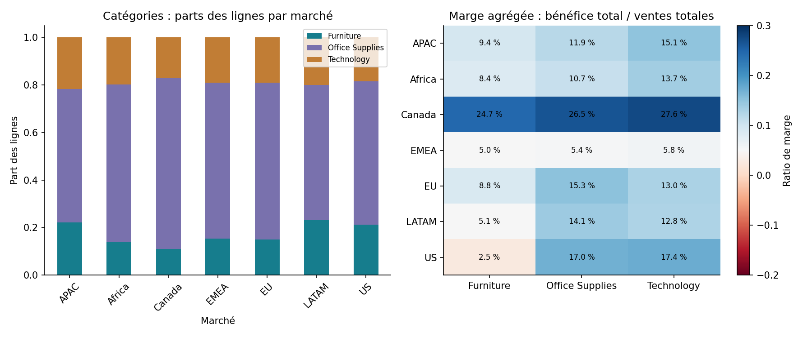
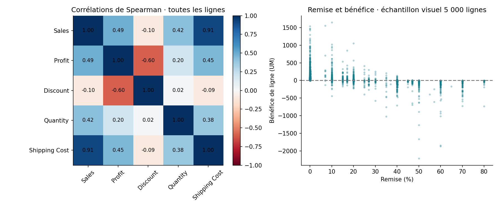
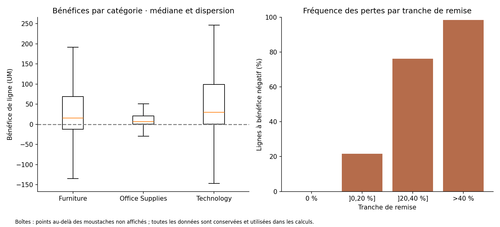

# Superstore — Relations entre ventes, catégories, remises et bénéfices
**Junior BOOTO Waba · Projet 3 · Analyse bivariée descriptive en Python**

Compléter le tableau de bord commercial par trois types de relations : catégories/marchés (quali-quali), distributions par catégorie (quali-quanti), corrélations entre variables numériques (quanti-quanti).

## Résultats exécutés
- 51 290 lignes de vente et 25 072 commandes distinctes.
- Marge globale : **11,6 %**, ratio bénéfice total / ventes totales.
- Remise/bénéfice : Pearson **−0,316**, Spearman **−0,596**.
- Association descriptive marché/catégorie : V de Cramér **0,074**.
- Marges agrégées : Furniture **6,9 %**, Office Supplies **13,7 %**, Technology **14,0 %**.
- 24,46 % des lignes ont un bénéfice négatif.

Ces relations ne prouvent pas les causes de performance. Remises, catégories, produits et montants sont liés par la construction des transactions ; le jeu est fictif.

## Reproduire
Python 3.11 ou plus :
```sh
python -m pip install -r requirements.txt
python analyser.py
```
Le script récupère le classeur officiel Tableau, vérifie son SHA-256, préserve les fichiers bruts et produit les CSV, graphiques et manifeste. Internet est nécessaire au premier lancement. Le classeur source n’est pas redistribué dans le projet.

## Analyses
- [Tableau croisé](analysis/effectifs_marche_categorie.csv) et [parts par marché](analysis/parts_categorie_dans_marche.csv)
- [Profils par catégorie](analysis/profils_categories.csv), [marché/catégorie](analysis/profils_marche_categorie.csv) et [marché/région](analysis/profils_regions.csv)
- [Tranches de remise](analysis/profils_remises.csv) et [remises par catégorie](analysis/remises_par_categorie.csv)
- [Pearson](analysis/correlations_pearson.csv), [Spearman](analysis/correlations_spearman.csv) et [corrélations par catégorie](analysis/correlations_par_categorie.csv)
- [Rapport](reports/rapport.md), [sources](reports/sources.md) et [manifeste](manifest.json)





## Contrôles et limites
Tous les tableaux groupés réconcilient lignes, ventes et bénéfices aux totaux sources. Les parts du tableau croisé totalisent 1 par marché. Le dénominateur des taux de pertes est le nombre de lignes, pas les commandes ou clients.

Les lignes d’une même commande ou d’un même client ne sont pas indépendantes. Aucune p-valeur ni causalité n’est annoncée sur une indépendance supposée. Le V de Cramér décrit la distribution du jeu ; il ne mesure ni un impact commercial ni l’importance d’une cause.

Les boîtes omettent visuellement les points extrêmes au-delà des moustaches, sans les retirer des calculs. Le nuage remise/bénéfice utilise 5 000 lignes tirées avec graine 42 ; les corrélations utilisent les 51 290 lignes.

Source fictive historique 2011–2014, unités monétaires du jeu (UM). Le bénéfice est un champ source, pas un résultat net comptable démontré. La marge est un ratio de totaux, pas la moyenne des marges individuelles. Pas de modèle ML : la question est descriptive.

Inspiration : *Data Analysis Projects*, Natacha Njongwa Yepnga / LeCoinStat, projet 3. Source : classeur officiel Tableau Global Superstore, déjà utilisé dans le tableau de bord du projet 7.
