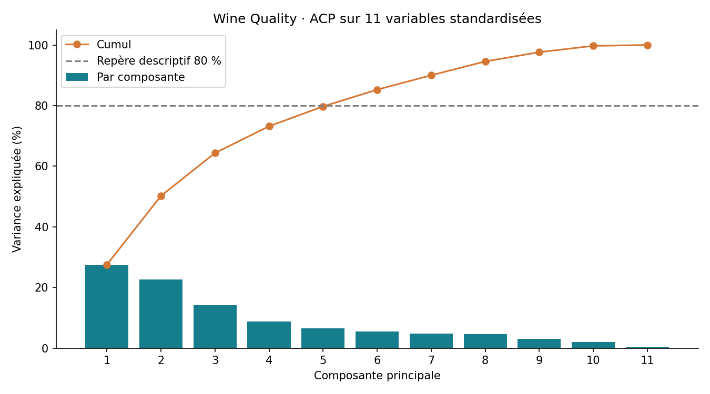
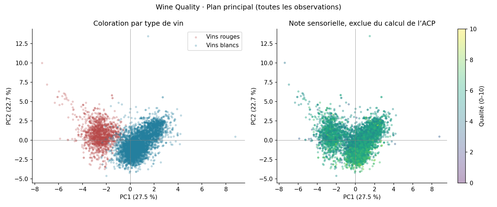
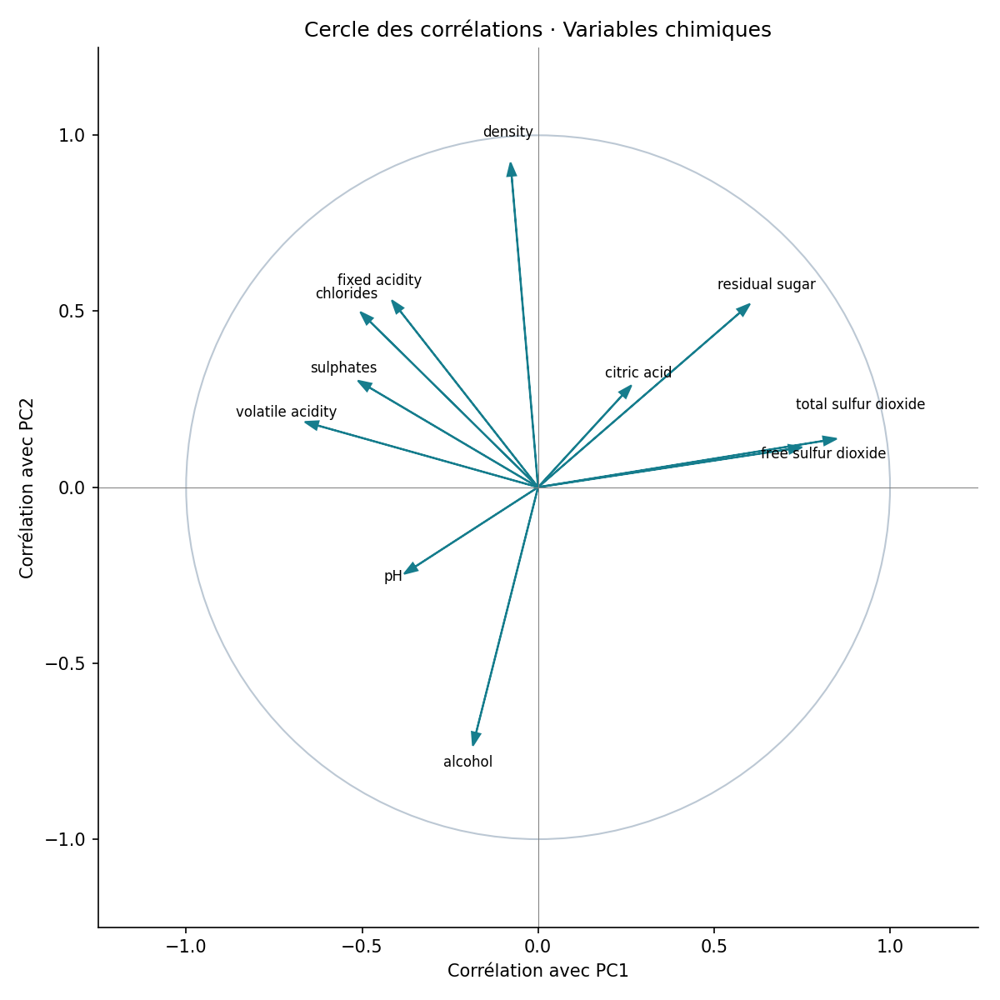

# Wine Quality — Explorer les profils des vins avec une ACP
**Junior BOOTO Waba · Python · Analyse exploratoire · Réduction de dimension**

Projet 6 inspiré de *Data Analysis Projects*, Natacha Njongwa Yepnga / LeCoinStat.

## Résultat
6 497 observations, 11 variables chimiques, aucune valeur manquante. Les deux premiers axes expliquent **50,2 %** de la variance ; trois axes en expliquent **64,4 %**. Il faut **6 composantes pour dépasser 80 %**.

L’ACP résume des propriétés chimiques. Elle ne démontre pas l’existence de segments clients et ne prédit pas la note de qualité.

## Reproduire
Depuis ce dossier, avec Python 3.11 ou plus :
```sh
python -m venv .venv
# Activer l’environnement selon votre système, puis :
python -m pip install -r requirements.txt
python analyse.py
```
Les données sources sont incluses : aucune connexion réseau n’est nécessaire pour réexécuter l’analyse.

## Parcours coordonné
- **DataCollect** : lecture des CSV UCI, conservation des sources, traçabilité par couleur et ligne, contrôle des types et des valeurs manquantes.
- **DataAnalyse** : statistiques, notes par couleur et examen des profils répétés.
- **DataML** : standardisation et ACP descriptive, analyse de sensibilité, export numérique et vérification du rechargement.

Ces rôles sont exécutés dans un même script avec un manifeste partagé. Ils ne correspondent pas à des appels automatiques aux trois GPT indépendants.

## Consulter
- [Rapport et interprétation](reports/rapport.md)
- [Sources et licence](reports/sources.md)
- [Dictionnaire des variables](collected/dictionnaire_variables.csv)
- [Variance expliquée](analysis/variance_expliquee.csv)
- [Analyse de sensibilité](analysis/sensibilite.csv)
- [Manifeste](manifest.json)





## Sources et limites
Wine Quality, Cortez et al. (2009), UCI, DOI **10.24432/C56S3T**, licence **CC BY 4.0**. Attribution et modifications documentées dans le dossier `reports/`.

L’analyse combine vins rouges et blancs du Vinho Verde portugais. La couleur et la note sensorielle sont exclues du calcul des axes. Les 1 177 profils répétés sont conservés : sans identifiant d’échantillon, leur origine n’est pas démontrée. L’ACP est ajustée à tout le jeu pour l’explorer ; aucune évaluation prédictive hors échantillon n’est revendiquée. La projection 2D perd presque la moitié de l’information et les signes des axes peuvent s’inverser sans changer leur interprétation.
